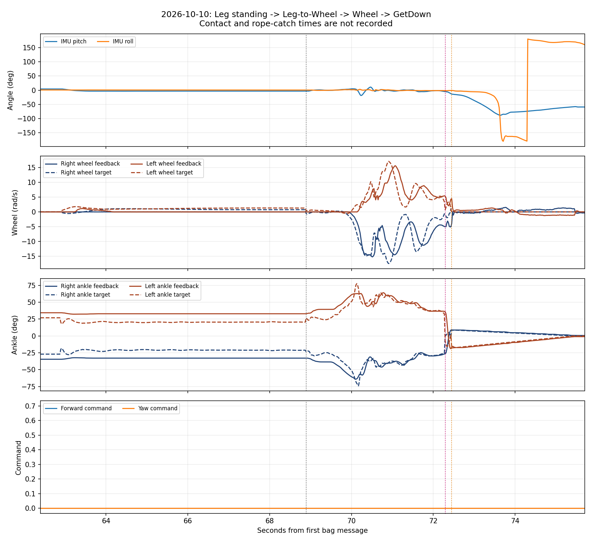
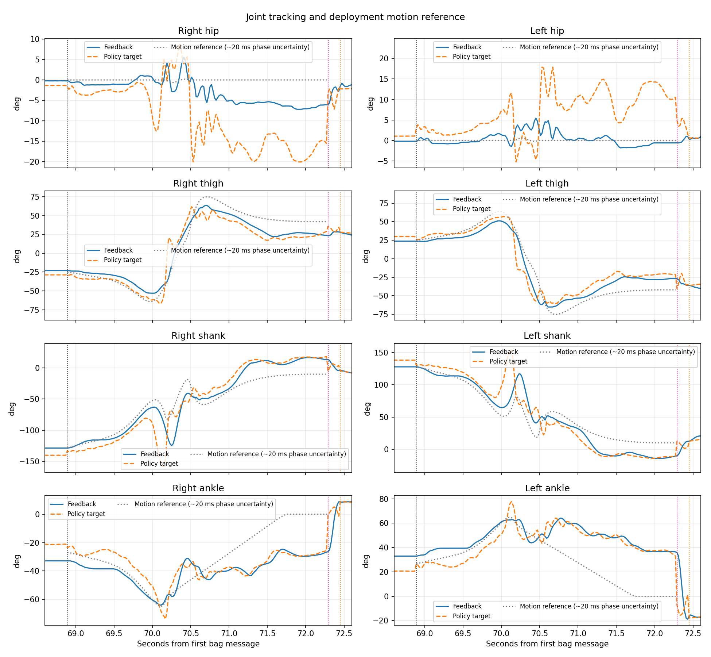
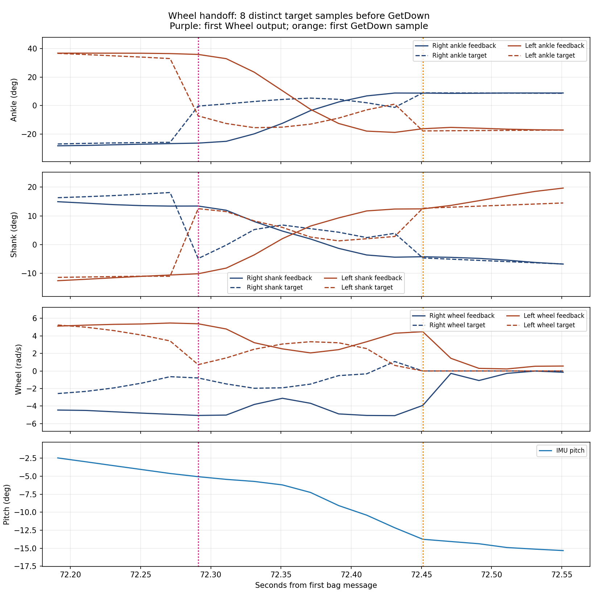

# 2026-10-10 双足站立→腿转轮→双轮→GetDown 实机评估

## 结论

本次转换动作执行到末尾，并自动切入双轮策略；用户随后进入 GetDown，最终回到 Passive。双轮策略接管后仅约 **0.160 秒**，bag 中可辨认 **8 组不同控制目标**，最合理的估计为约 **8 个 20 ms 策略步**。从腿转轮启动计数，则约为 **170 个转换步 + 8 个双轮步 = 178 步**。这些是策略更新步；200 Hz 底层控制周期为 5 ms，双轮段相当于约 32 次底层循环。bag 未记录策略 frame/generation，不能把采样输出数量当作绝对精确的推理总次数。

猛冲前的高速轮速已经出现在 **腿转轮转换策略** 内，不能全部归因于短暂的双轮策略。转换末端关节姿态偏离部署参考，接管时脚踝/膝关节目标又发生明显突变，两种效应均值得重点排查。现有数据不足以判定唯一根因、准确落地时间或吊绳受力时间。

## 现场条件和证据

- 用户：吊绳松弛，人扶着进入双足初始位姿；在启动双足策略前不久松手；全程保持零前进、零转向指令。转换落地后持续前冲，随后吊绳拽住机器人，再按 GetDown。
- 原始 bag：`/home/nvidia/debug_bags/lw_real_20261010-203035/lw_real_20261010-203035_0.db3`。
- SHA-256：`743435466892ede0a16155e9cf5da2adca7056dba0cb1bd2bd84ab517f231fce`。
- 共 4055 帧、81.070783 秒；2026-10-10 20:30:48.583315—20:32:09.654097，UTC+08:00。
- 唯一话题为 50 Hz `/LW_joint_states`；26 个名称，记录关节位置/速度/电机板反馈力矩、命令目标、IMU 四元数和角速度及操作指令。
- 自定义 CDR 解码结果与 ROS 官方反序列化逐帧逐值核对，4055/4055 帧所有浮点值位模式一致。数据均有限，帧间隔中位数 19.996 ms、最大 24.952 ms。
- 终端原文保存在 `terminal.log`；和 bag 启止时间吻合。
- 实际启动日志明确验证部署提交 `a5736756b397c7343c63b32f8e36749b93bb39f3`，包为 `build/lw_deployments/a5736756b397`。包内策略/配置/动作 CSV 共13项及可执行文件重新通过清单 SHA-256 校验。
- 腿转轮模型归档为 `2026-10-09-12-49-52`，ONNX SHA-256 为 `9a809a0f122e56da6d1cc84503bffcd0c1d3ebc67be99d6d7fff90bfedc9e4f7`。与 `8cd9a7c` 比较，控制源码、四策略配置、动作 CSV、Leg/Wheel 模型未改变；变动为腿转轮模型、固定输出测试基线及学习文档。

## 时间线与步数

下面的边界为“第一次采样到该阶段目标”的时间。实际状态切换通常在相邻两帧之间，边界分辨率约 20 ms；激活后等待首次输出、发布延迟和退出边界也会影响绝对计数。

| 阶段 | bag 相对时间 | 本地时间（首个目标样本） | 观测/评估 |
|---|---:|---|---|
| 起身完成后的固定 PD 位姿 | 9.761—62.891 s | 20:30:58.344 起 | 人松手的精确时间未录制；不能把整段都当无人辅助 |
| 双足站立策略 | 62.891—68.891 s | 20:31:51.475 | 约6秒、300帧，全程零操作速度指令 |
| 腿转轮 | 68.891—72.291 s | 20:31:57.474 | 3.400秒、170帧；CSV 204帧/60Hz，持续3.383333秒 |
| 双轮策略 | 72.291—72.451 s | 20:32:00.874 | 0.159991秒、8组不同目标 |
| GetDown | 72.451—75.451 s | 20:32:01.034 | 双轮目标速度从首帧起为零；非轮关节3秒插值收腿 |
| Passive | 约75.451—81.071 s | 约20:32:04.034 | 终端确认从 GetDown 回到 Passive，随后用户 Ctrl+C |

终端顺序为 Leg→LegToWheel→Wheel→GetDown→Passive。转换末尾通过进度完成条件自动请求 Wheel，Wheel 状态再通过用户 B/9 请求 GetDown；没有 GetDown 后再次进入 Wheel 的记录。

进度 **99.9%** 表示动作时间接近结束，既不是接触检测，也不代表实际关节已经到达参考终态。目前转换结束条件使用策略帧计时，而非轮子落地/速度收敛/末端姿态合格条件。

## 双足站立和转换表现

双足策略进入后完成一次小幅姿态调整，转换前后半段俯仰约 -3.32°～-3.02°、横滚约0.50°～0.72°，没有持续增大的摆动。该站立段仅6秒，不能代替长时间稳定性验收。与固定PD末段约 +4.18°俯仰相比，策略站立平衡姿态有改变。

腿转轮实现了显著屈伸变化，用户观察也确认发生了腾空和双轮落地；bag没有基座高度、线速度、加速度或接触信号，不能仅据关节/IMU测量跳高、腾空时长、落地时刻和前冲距离。

转换段俯仰范围约 -18.71°～+10.99°，横滚约 -1.73°～+3.06°。快速屈伸阶段（相对时间70—71秒）膝关节目标跟踪误差RMS约右31.44°、左30.24°，实际关节速度峰值约右10.91、左9.24 rad/s，表明高速转换阶段存在显著动态跟踪误差。这些数据不能独立区分执行器带宽、负载、模型适配、姿态/接触差异和外力影响。

## 前冲相关证据

### 1. 转换策略已产生大轮速

转换阶段目标轮速绝对峰值为右17.532、左17.151 rad/s，出现在相对时间70.911秒，约为167/164 rpm。反馈峰值为右15.264、左15.659 rad/s，约146/150 rpm。右负、左正须按左右关节轴方向解释，不能把符号相反直接解释为原地转圈。

在切入 Wheel 前最后一帧（72.271秒），实际轮速仍为右-4.934、左+5.462 rad/s。因此 Wheel 接管时机器人已经带有明显轮子转速，不能将前冲解释成“Wheel 接管后从静止突然产生了最高轮速”。

动作 CSV 的轮角位置微小变化，经60Hz中心差分所得参考轮速峰值仅约0.136 rad/s。实际策略轮速明显大于该参考；参考并不是对网络输出的硬约束，空中轮子旋转也可能参与姿态调节，故不能仅据此宣称模型错误。但需要核对空中轮速控制及接触时是否保留了不合适的轮速。

从双足策略进入到退出，全段记录的前进、侧向和转向指令都严格为零，与用户描述一致。起始Passive段约2.24秒存在非零输入记录，之后已清零，距离本次转换约一分钟，不能据此归因于猛冲时存在前进指令。

### 2. 转换末端没有收敛到轮式参考姿态

下表使用转换最后一个采样点（72.271秒）和动作CSV终态比较，顺序均为右/左，单位度。末端参考在相邻20ms内近似不变，差异远大于相位分辨率影响。

| 关节 | 动作参考终态 | 实际关节角 | 转换策略目标 |
|---|---|---|---|
| 髋 | 0 / 0 | -6.04 / -0.58 | -15.50 / +10.54 |
| 大腿 | +42.00 / -42.00 | +23.64 / -26.85 | +29.08 / -21.24 |
| 小腿/膝 | -10.00 / +10.00 | +13.41 / -10.59 | +18.14 / -11.02 |
| 脚踝 | 0 / 0 | -26.74 / +36.45 | -25.84 / +32.94 |

不仅实际关节未贴合参考，转换策略的目标本身也明显偏离参考终态。末段脚踝实际较接近转换策略自己的目标，因此此时脚踝偏斜不能只归因于“电机跟不上零度目标”。

### 3. Wheel 接管带来较大的目标突变

相邻两帧（72.271→72.291秒）控制目标变化：
- 髋：右+12.37°、左-5.65°。
- 大腿：右+6.62°、左-19.09°。
- 膝：右-23.00°、左+23.53°。
- 脚踝：右+25.45°、左-40.22°。

该交接没有启用目标插值，Wheel 激活会重新初始化观测历史和 previous action；配置中两策略对应的PD增益相同，所以交接突变首先体现在目标及策略状态初始化，不是两者PD增益突然变化。

Wheel段首末采样间约0.140秒，实际脚踝变化为右+35.15°、左-54.73°，实际速度峰值约右6.63、左11.58 rad/s；IMU俯仰由约-5.07°变至-12.16°。这一时段也可能已经受到吊绳外力，不能把全部响应强行归因于控制目标。可以确认的是：系统在已有轮速、未收敛的末端姿态下发生了较急的策略接管。

Wheel目标轮速在这8帧内绝对值不超过约右1.971、左3.330 rad/s，远低于转换阶段17 rad/s级峰值。部分时刻已要求减速，不能把它描述成Wheel持续输出最高轮速导致猛冲。

## GetDown和运行时

首个 GetDown 样本在72.451秒，双轮速度目标均为零，并一直维持到结束。源码显示非轮关节向收腿位姿执行3秒插值，并使用固定PD；轮子由速度目标零和固定阻尼进行制动，GetDown不是跳跃落地恢复控制器，也不是瞬时物理停车。

吊绳在 GetDown 前已经受力。后段IMU出现大幅俯仰/横滚变化，包含吊绳牵引、失去原接触支撑和收腿等因素；不能把它直接标成“Wheel自主控制导致摔倒”。未记录吊绳受力，无法量化其影响。

终端没有本次 IMU stale、S4、姿态S2锁存或策略激活失败记录。唯一1次控制截止时间遗漏已在前段计数5798附近出现，远早于本次切换；之后未增多。日志不支持将本次猛冲主要归因于连续控制调度崩溃，也不能据此证明每次反馈都及时。

力矩字段边界：当前关节effort来自电机板 `motor_tor_now`，未经独立力矩传感器校准；目标effort是调试发布器按初始化配置计算的PD估计，不是逐帧实际发送的增益/力矩。bag未录制kp/kd和电流，不能直接用这些字段证明实际力矩饱和或电流限制。

## 后续排查优先级（未实施代码修改）

1. 优先追踪转换阶段轮速输出和真实接触时刻的关系；现有记录已表明大轮速先发生在转换策略。
2. 核对新腿转轮模型训练端的动作参考、动作/轮速语义及部署端资源。此次只更新模型、CSV未变是版本事实，但尚不是资源不匹配的证明。
3. 分别检查转换末端姿态未收敛和直接激活Wheel带来的目标突变。是否增加完成准入、目标过渡或历史交接属于待论证方案，不应直接动参数掩盖原因。
4. 如需精确计数和归因，后续记录FSM状态、策略generation/frame、已应用输出sequence以及时间戳，并同步现场视频/接触/吊绳受力事件。该采集方案涉及代码时，必须另行说明方案并取得用户明确批准。

本次只读分析，没有修改源码/策略/配置、运行机器人、改变保护、提交或推送。分析产物位于原仓库已忽略的build诊断目录，原bag和已有文件保留。

## 图与可复核产物

- `source.json`：bag哈希、时间及消息布局。
- `metrics.json`：阶段边界、统计、计数限制与现场说明。
- `deployment-provenance.json`：部署来源和逐文件校验。
- `decoded.npz`：4055帧解码数据。
- `terminal.log`：用户贴出的原始终端打印。
