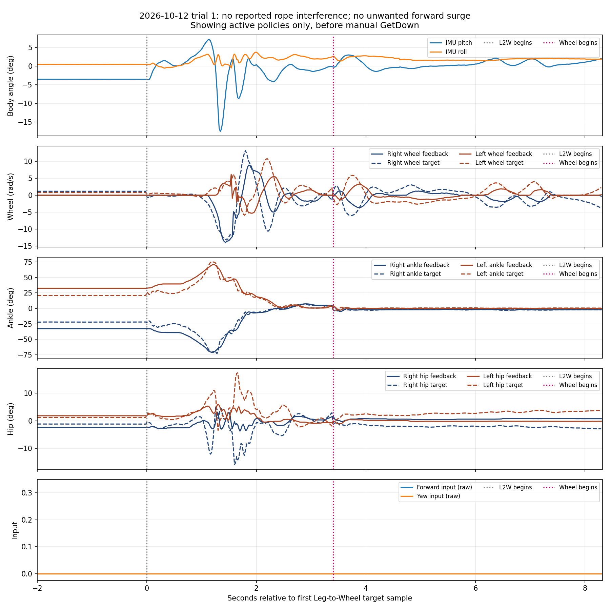
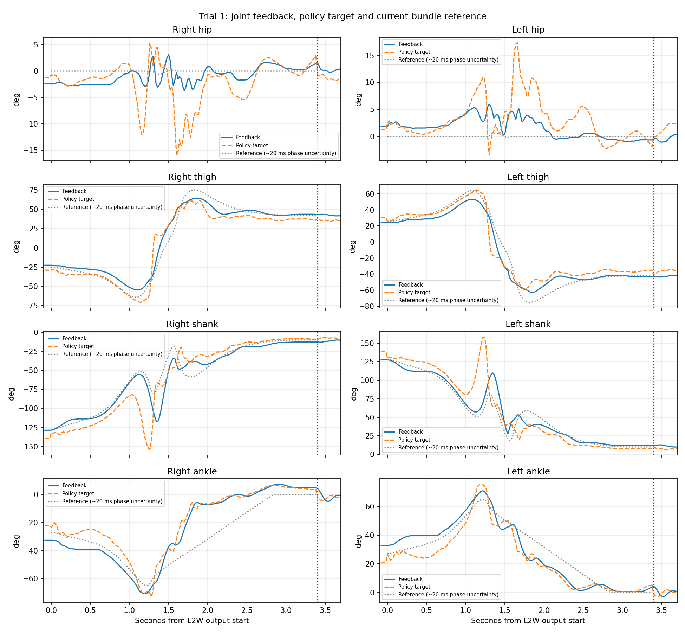
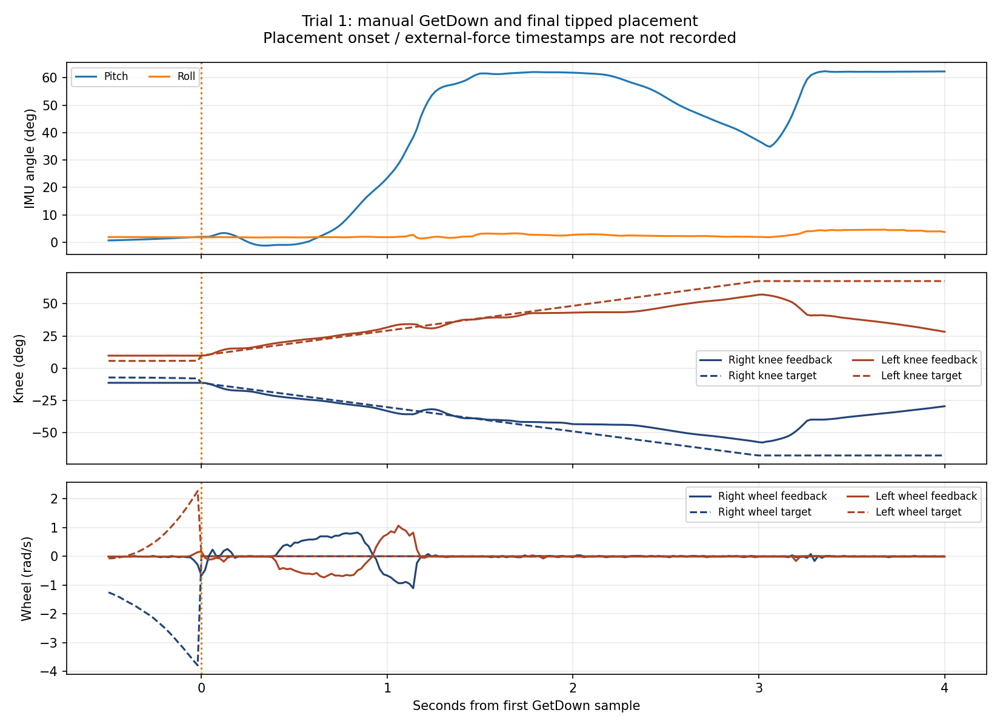

# 第一轮 Leg-to-Wheel：151931

本轮为全程零操作速度输入、无吊绳干扰测试。用户确认无非预期前冲；Wheel接管后轮子着地、脚板离地，约4.92秒后主动GetDown，最终倾倒放地。

原bag：/home/nvidia/debug_bags/lw_real_20261012-151931/lw_real_20261012-151931_0.db3；8195帧、163.862752秒。SHA-256：6d4f88a3cb7831fbfa8af70620df1c6fdeb914eca0039d6a43d96e701e5f0bc2。时间Asia/Shanghai，15:19:46.176662—15:22:30.039415。

Leg目标首次变化15:20:57.259；LegToWheel首次输出15:21:13.198，转换170帧/3.399951秒；Wheel首次输出15:21:16.598，246组不同目标/4.919967秒；GetDown首次目标15:21:21.518。阶段边界为50Hz采样推断，约20ms分辨率，没有精确推理计数器或直接FSM状态。

转换前最后1秒姿态稳定，俯仰-3.55°～-3.53°。转换中俯仰-17.55°～+7.15°，实际轮速峰值右13.99、左6.16rad/s；转换末端轮速已近零。末端大腿实际+43.38°/-42.76°、膝-12.71°/+11.68°、脚踝+4.78°/+3.92°，相对当前包参考轮式终态的误差较小。Wheel接管脚踝目标跳变约-5.96°/-6.01°，实际0.14秒变化约-9.31°/-6.86°。

Wheel阶段俯仰-1.41°～+3.01°、横滚+1.38°～+2.78°。有小幅往复轮速，峰值3.59/3.29rad/s，不能描述成绝对静止。末2秒髋均值+0.74°/-0.20°、脚踝-1.99°/-0.21°，在该短窗口内没有扩大到旧绳拉场次的严重偏斜。

快速转换1～2秒，膝PD目标与实际角的差值RMS约33.32°/33.97°。在PD力矩控制中，该差值用于产生支撑和加速力矩，不能据此判定实际运动跟踪差。评价参考轨迹跟踪需另外比较实际角与动作参考，评价力矩需求需包含速度项及执行器约束。根据用户说明已修正原有“明显滞后”的解释，原统计不变。

GetDown起双轮目标均为零；机身后段转至约62.66°，与用户确认的倾倒放地相符，归为退出过程。完整终端stdout、接触与外力时间戳、机身位置/线速度未记录，不能量化跳高、冲击或长期稳定性。当前参考包a5736756资源校验通过，实际测试进程版本未独立捕获。

用户新确认上次异常为中途吊绳拉拽导致，本轮作为无绳、零指令对照评价。详见[总评估](../assessment.md)。

数据与来源见source.json、metrics.json、decoded.npz和logs/。没有修改代码或运行硬件。
